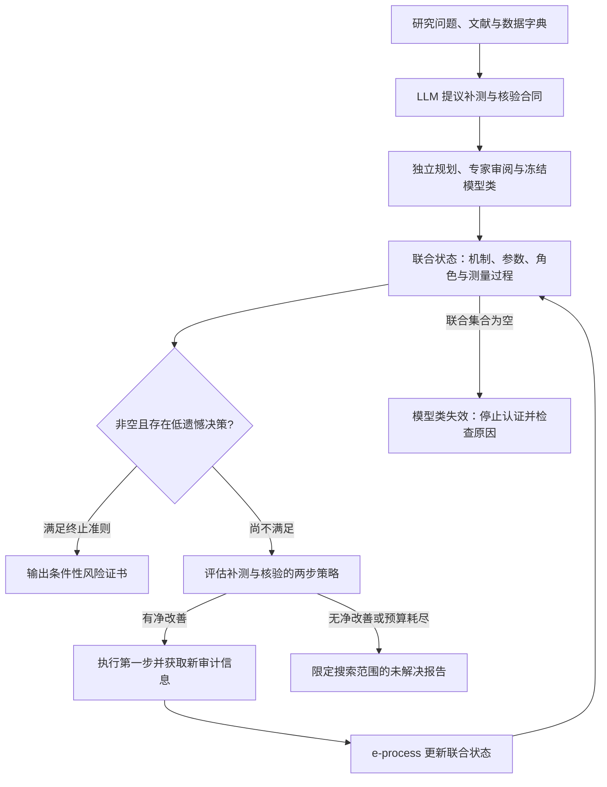

# 补测还是核验？见证有效性不确定下的联合序贯规划

**英文拟题：** *Measure or Validate? Joint Sequential Planning under Uncertain Causal Witnesses for LLM-Assisted Real-World Evidence*  
**中文拟题：**《补测还是核验？面向 LLM 辅助真实世界证据的因果见证联合序贯规划》  
**版本：** 0.3，方法学重构稿，2026-11-16。  
**状态：** 研究提案。下文给出拟实现的有限模型算法、条件性统计结论及实验协议；尚无软件实现、实验结果或临床有效性证据。

> 本文的主问题是：当额外变量既可能帮助区分因果解释、又可能不满足所声称的负对照或代理假设时，系统应先补测变量，还是先核验测量与角色假设？本研究拟联合维护“因果机制—见证有效性”的相容集合，在预算内规划补测与核验，并仅在决策遗憾得到条件性上界时输出稳健结论。

LLM 的作用是从文献、研究协议和数据字典提出可执行的测量与核验动作。方法学核心拟落在联合假设更新、补测与核验的互补性规划，以及自适应采集后的风险证书。价值信息、最小最大遗憾、序贯检验、部分识别和 LLM 候选生成均有既有基础，不能单独作为首创主张。最终新颖性须经过相邻方法的正文、代码和引用链比较确认。

## 1. 论文主线与研究边界

### 1.1 为什么需要联合规划

假设某项 RWE 研究观察到治疗 A 与较低的结局风险相关。因果解释可能是治疗有效，也可能是未测健康状态影响了治疗分配和结局。LLM 可以建议补充治疗前功能状态、增加负对照或核验用药时间，但这些建议本身依赖假设：功能状态记录可能反映治疗后的恢复，负对照可能受到治疗影响，用药时间也可能存在系统误码。

因此，新增变量不能自动视为有效证据。某项检验与预期冲突，可能来自原因果机制错误、见证角色错误、测量误差或选择机制错设。若把冲突直接用于删除因果图，系统可能获得一个错误但看似确定的结论。本研究将这些解释保留在统一的联合状态中，并把“核验既有证据是否可信”作为与“继续补测新证据”竞争的正式动作。

本研究主要面向非干预性的数据采集和研究审计。采集动作改变研究者掌握的信息，不主动分配患者治疗。合成轨道中的策略选择具有预注册效用；真实 RWE 轨道只输出研究结论的稳健性、未解决假设和证据缺口，不直接生成自动治疗建议。

### 1.2 四个研究问题

| 编号 | 研究问题 | 拟验证内容 |
|---|---|---|
| RQ1 | 联合维护机制与有效性，能否减少错误归因和过早淘汰真实机制？ | 对照“检验冲突即删图”及“全部见证有效”的更新规则。 |
| RQ2 | 同时规划补测与核验，能否优于只补测、固定先核验或一步贪心？ | 在存在动作互补性的任务中比较风险、采集成本和可认证报告率。 |
| RQ3 | 在声明的模型覆盖与检验条件下，自适应采集和停止能否维持风险证书的有效性？ | 检查联合真状态保留、序贯检验与报告错误事件。 |
| RQ4 | LLM 的语义候选生成是否提供超出固定候选库的增量？ | 分开评价候选生成、规划算法和端到端系统。 |

CEPM 在本论文中承担过程评价：记录图、有效性假设、效应集合、外显置信、动作和修订轨迹。相位标签、恢复轮数和错误持续性是次要分析，不承担主要方法新颖性，也不预设一定存在“认知相变”。

### 1.3 当前材料如何进入研究

[RESEARCH_PLAN](RESEARCH_PLAN.md) 提供见证采集与符号约束设想；[RWE 协议](RWE_STUDY_PROTOCOL.md) 提供研究单元、时间零点和结论边界；[CEPM 方案](Causal_Epistemic_Phase_Mapping_研究方案.md)、[CEPM 理论草稿](Causal_Epistemic_Phase_Mapping_Typora.md) 和 [AI4Metascience 执行方案](AI4Metascience_医疗真实世界因果推断_Benchmark_从Idea到执行.md) 提供动态状态与分层验证设计；[已有创新性检索](CEPM_相关研究检索与创新性分析.md) 提供需要核对的先行工作。

[MIMIC 摘要索引](../../datasets/literature/sources/pubmed_index.txt)、[15 个公开数据库的报告与索引](public_database_search.md) 和 [全文下载说明](../../datasets/metadata/README.md) 用于构造研究语境、测量定义与检索语料。其“新风险因子”“预测因子”标签不能作为因果角色真值。长篇索引已按数据库、筛选规则和代表性条目作语料级梳理，尚未对其中每篇文章完成全文系统评价。

## 2. 方法贡献的定位与先行工作

### 2.1 拟议的三项方法贡献

**联合状态更新。** 将因果机制、效应参数、见证角色、测量误差和选择机制作为相互约束的联合假设，明确规定从一次冲突到删除联合状态、再到排除整张图所需的条件。贡献需要落实到可计算更新器和错误保留分析，不能停留在 JSON 合同或专家审核流程。

**补测与核验的联合序贯规划。** 将补测变量和核验其测量/角色后果纳入相同动作空间，在同一未知世界下评估完整动作策略。优先实现小规模两步策略树，以覆盖“单独做任一步均不足、组合后才有用”的互补性。两步规划及稳健价值信息本身是既有思想；拟议增量是它们与因果见证联合有效性状态和证书约束的具体算法结合。

**受审计约束的报告规则。** 将可接受的决策遗憾上界与联合置信集合连接，区分可认证报告、有限规划下未解决、预算耗尽和模型类失效。全时覆盖到报告风险控制的推导是已有置信集理论的直接应用，不独立宣称为原创定理。需要研究的是拟议更新与规划实现是否满足这些条件，以及近似、模型遗漏和见证失效时哪些结论会失去保证。

双生因果世界、核验互补任务和 CEPM 轨迹是支撑上述贡献的评测方法。若联合算法无法提供超出既有方法的增量，论文应定位为专项基准与比较研究，而不继续宣称新因果算法。

### 2.2 必须正面比较的相邻工作

| 先行工作 | 已覆盖的问题 | 本研究的候选差异与复核要求 |
|---|---|---|
| [DANCE，JMLR 2024](https://jmlr.org/beta/papers/v25/22-1062.html) | 特定负对照的自动搜索、验证与因果估计。 | 自动发现负对照不作为创新。须比较其有效性假设、验证信息及适用数据，与“先补测还是先核验”的预算规划是否重合。 |
| [Fortified Proximal Causal Inference，2025 预印本](https://arxiv.org/abs/2506.13152) | 在规定有效代理数量等条件下，容许部分治疗混杂代理无效并进行因果识别/估计。 | 不能将“允许无效代理”列为独立创新。需核对其识别假设和估计器；本方案拟研究采集之前的动作选择与机制—有效性联合状态，而非另称一个代理稳健估计器。 |
| [Adaptive Proximal Causal Inference，2025 预印本](https://arxiv.org/abs/2507.19623) | 在特定结构方程设置下选择有效代理并估计效应，包含自适应惩罚方法。 | 不能把“选择有效代理并估计效应”宣称为新问题。这里的序贯规划与该摘要中的自适应惩罚不同，但最终差异须阅读全文和代码确认。 |
| [ACED，2026 预印本](https://arxiv.org/abs/2610.14381) | 隐藏因果环境中，LLM Agent 通过观测、实验和预算获取证据并作决策。 | 不把通用因果证据获取 Agent 或预算评测作为贡献。需核对其观测动作、核验动作、角色失效模型和停止机制。 |
| [主动因果图学习，JMLR 2008](https://jmlr.org/papers/v9/he08a.html)；[双变量主动学习，ICML 2025](https://proceedings.mlr.press/v267/wang25bp.html) | 选择干预以区分因果结构或方向。 | 非干预式测量与干预设计须分清；在兼容子任务上对照结构信息目标与决策损失目标。 |
| [Adversarial Causal Intervention Falsification，2026 预印本](https://arxiv.org/abs/2608.06427) | 分歧驱动的序贯干预与因果机制证伪。 | 主动证伪不作为创新。需重点核对其模型集合、淘汰规则、统计保证和规划目标。 |
| [Causal-LLM，EMNLP Findings 2025](https://aclanthology.org/2025.findings-emnlp.439/)；[临床文本协变量研究，MLHC 2026](https://proceedings.mlr.press/v340/liu26b.html) | LLM 因果图发现；从临床文本提取混杂信息并纳入估计。 | 图生成、病历抽取和标准估计器接入均为候选生成或数据模块，不能单独算方法创新。 |
| [SAVI，Statistical Science 2023](https://arxiv.org/abs/2210.01948)；[全时置信序列，Annals of Statistics 2021](https://arxiv.org/abs/1810.08240) | 序贯检验、e-process 和数据依赖停止下的统计有效性。 | 直接使用既有统计基础并明确引用，不声称发明新的 e-value；需验证本方案条件核与采集机制是否支持这些基础。 |
| [因果决策与效应估计的区别，2022](https://pubsonline.informs.org/doi/10.1287/ijds.2021.0006) | 强调决策目标与精确效应估计并非同一任务。 | 决策遗憾目标和“效应未点识别但决策稳定”不能单独作为首创。 |

以上是定向检索和已读取原始页面所支持的边界，不是排除所有同构方法的系统综述。两篇无效代理论文本轮核对了原始摘要和元数据，尚未逐项复现其完整方法。投稿前须检查最新发表状态、后向/前向引文及实现；不得使用“首次允许无效见证”“首次主动获取因果证据”等表述。

## 3. 形式化对象：机制、有效性与观测过程

### 3.1 联合世界与可见信息

设一个联合世界为：

$$
h=(G,\theta,\eta)\in\mathcal H_0.
$$

其中 $G$ 是待审计的核心因果机制，$\theta$ 为完整结构方程及效应参数，$\eta$ 包含见证的扩展连接、角色限制及测量/选择机制。完整图由核心图和见证扩展共同确定。本文将同一核心机制配上不同见证扩展视为不同联合状态；若扩展改变核心机制本身，则另登记为不同的 $G$。因此后文图投影保留的是核心图，不把不同见证扩展称为同一张完整图。

角色假设必须与完整图和参数相容；$\mathcal H_0$ 不是随意组合标签的笛卡尔积。例如“负对照不受治疗影响”须对应完整结构中的路径限制，而非独立写一个 valid=true。

初版核心算法限制在**有限且预先登记的联合假设类**。每个世界须给出可执行数据生成模型、目标效应、效用及所有允许采集动作的预测分布。连续参数的扩展须使用有覆盖性的参数集合或保守包络；任意离散网格不保证包含真实参数。

$\mathscr F_t$ 表示第 $t$ 轮后的可见历史，包括先前请求、实际获得的数据、审计结果、成本和版本化输出。真实世界索引 $h^*$ 保存在评估器中。规划器可以使用公开的候选机制与参数范围，但不能读取真实索引、真实效应标签或未来观测。所有可比较规划基线使用相同候选模型信息。

有限类实验中“给出一组可执行候选世界”和“告诉模型哪个世界是真的”是不同信息。前者是模型化规划的输入，后者是禁止泄漏的评分标签。开放式 LLM 场景不具备完备模型类时，只作探索性推理，不能沿用有限类保证。

### 3.2 补测动作与核验动作

动作集合写为：

$$
\mathcal Q_t=\mathcal Q_t^{\mathrm{measure}}\cup
\mathcal Q_t^{\mathrm{validate}}.
$$

补测动作获取额外观测，例如治疗前功能状态、候选负对照、预先定义的代理或新的结局来源。核验动作获取有关测量/角色后果的信息，例如与参考记录比对时间戳、抽样复核提取标签、验证单位或编码、在有参考标准的子样本中估计误分类率。每个动作必须包含人群、抽样方式、样本量、时间窗、来源、成本和允许输出的定义。

核验不能直接观察“这个变量真的满足排除限制”或“没有任何未测共同原因”。参考标准的测量准确性不等于因果角色成立。不能由可观测核验支持的角色限制必须继续作为敏感性假设保留。

每个可执行世界规定条件观测核：

$$
Z_t\mid\mathscr F_{t-1},q_t,h
\sim K_h^{q_t}(\cdot\mid\mathscr F_{t-1}).
$$

这里 $Z_t$ 是新增数据或预登记统计量。核必须包含采样、缺失、测量误差和选择过程。不能用生成器的真实参数给规划器提供 $K_{h^*}$；规划器面对的是全部相容候选核。真实应用中不具备可信预测核的动作，不获得模型化最坏风险保证。

### 3.3 有效性不确定集合的来源

| 来源 | 可以约束什么 | 不能据此确认什么 |
|---|---|---|
| 编码字典与时间戳规则 | 单位、可观测时间顺序、字段来源和允许窗口 | 所有未测混杂或排除路径不存在 |
| 独立标注/参考测量子样本 | 在规定人群和抽样下的误分类、缺失与提取误差范围 | 该变量在其他中心仍有相同角色和误差 |
| 临床/领域专家审阅 | 假设的合理范围、明显不允许的路径和失败方式 | 将合理性评价当作因果真值 |
| 模拟生成器 | 给定 DGP 下的角色、误差和参数真值 | 真实临床的普遍有效性 |
| 敏感性边界或有效代理数量条件 | 在明确假设下限制可能失效的集合 | 从同一数据证明这些限制必然成立 |

若允许所有见证任意失效，且没有额外有效性限制或区分信息，竞争机制可能始终无法排除。系统必须保留这种不可判定性；不能为了获得结果而临时删除不利的无效性分支。

## 4. 联合状态更新与图的投影

### 4.1 只排除有证据不相容的联合解释

第 $t$ 轮审计得到相容联合集合 $\mathcal H_t$。仍可接受的图为：

$$
\mathcal G_t=
\left\{G:\exists\,\theta,\eta\ \text{such that}
(G,\theta,\eta)\in\mathcal H_t\right\}.
$$

某个 $(G,\theta,\eta_{\mathrm{valid}})$ 被拒绝，不意味着 $G$ 被排除；可能仍存在同图下的其他参数或失效机制解释结果。只有当该图全部已登记联合解释均被排除，才可说“该图在当前模型类中没有相容实例”。仍不能据此声称排除了所有现实世界因果机制。

效应集合同时按联合状态投影：

$$
\Psi_t=\left\{\psi(h):h\in\mathcal H_t\right\}.
$$

报告应保留来源标签，说明不确定性来自图差异、参数、角色假设还是测量机制。若不同来源产生相同观测分布，只能报告无法区分，不能按语言解释的说服力强制归因。

### 4.2 空集合、模型修订与数据自适应扩展

若 $\mathcal H_t=\varnothing$，系统输出“登记模型类与数据不相容/需检查实现”，不得将空集合上的最大值当作零风险。先核对数据处理、观测核、假设遗漏和检验实现；是否新建机制类属于方案偏离或新推断轮次。

第一版确认性实验在审计前冻结见证池、角色配置和联合模型类。LLM 可以根据历史重新选择已登记动作，不能在看到结果后添加一个事后拟合的机制并宣称仍享有原始保证。若扩展模型类，需要新推断协议、独立信息或已证明适用于扩展的构造；原证书不自动继承。

## 5. 决策损失与补测—核验规划

### 5.1 决策、弃答和两种风险

设实质决策集合为 $\mathcal D$，效用 $U(d,h)$ 在实验前规定。决策遗憾为：

$$
r(d,h)=\max_{d'\in\mathcal D}U(d',h)-U(d,h),
\qquad 0\le r(d,h)\le 1.
$$

当前决策风险上界与最小最大遗憾定义为：

$$
\overline r_t(d)=\sup_{h\in\mathcal H_t}r(d,h),
\qquad
R_t=\min_{d\in\mathcal D}\overline r_t(d).
$$

$R_t$ 是候选世界内的保守量；实验评分另外使用隐藏真值下的 $r(d,h^*)$。二者不可混用，也不把当前集合内风险自动等同真实临床风险。

弃答记为 $\bot$，其评估损失为预设的 $\kappa\in(0,1)$。弃答不加入实质行动的最佳效用基准，以免“永远弃答”改变遗憾定义。定义终止损失：

$$
\ell(o,h)=
\begin{cases}
r(o,h), & o\in\mathcal D,\\
\kappa, & o=\bot.
\end{cases}
$$

$\kappa$ 及临床效用属于研究设计选择，应报告敏感性分析，不能通过测试集调节以改善排名。

### 5.2 带证书的终止规则

在非空集合上，只有当某个决策满足 $\overline r_t(d)\le\epsilon$ 时，才允许输出“在登记模型类下遗憾不超过 $\epsilon$”的证书。否则可以继续采集，或报告未解决并弃答。为了计算规划损失，终止策略在允许的可认证决策与弃答之间选择；每个基线使用同一 $\epsilon,\kappa$ 和证书门槛。

这将效应点识别与决策稳定分开：$\Psi_t$ 可以包含多个效应值，而所有状态仍允许同一低遗憾决策。证书的范围必须列出 $\mathcal H_0$、未检验角色限制、误差边界和采样条件。

### 5.3 为什么要评估完整策略

令 $\pi$ 为根据可见历史选择下一项补测、核验或终止输出的策略。剩余规划深度为 $L$，所有分支须满足剩余预算。拟优化：

$$
J_L(\pi\mid\mathscr F_t,\mathcal H_t)=
\sup_{h\in\mathcal H_t}
\mathbb E_h^\pi\left[
\ell(o_\tau,h)+
\sum_{s=t+1}^{\tau}
\left\{\lambda_c c(q_s)+\lambda_b b(q_s)\right\}
\mid\mathscr F_t
\right],
$$

$$
\widehat\pi_L\in\arg\min_{\pi\in\Pi_L^{\mathrm{cert}}}
J_L(\pi\mid\mathscr F_t,\mathcal H_t).
$$

$\Pi_L^{\mathrm{cert}}$ 表示使用共同证书规则、预算可行且只依赖可见信息的策略树；$\tau$ 为其终止轮次。$c$ 是采集资源成本，$b$ 是预先折算的额外测量负担，权重在测试前固定。隐私和伦理等禁止条件首先作为可行性约束，不以支付惩罚项的方式允许违规动作。

同一策略必须在所有未知 $h$ 下执行。不能先假设知道哪个见证有效，再分别为不同有效性配置选择最佳行动；那会得到现实系统无法达到的乐观价值。最坏世界在一条路径上保持为同一 $h$，不会在每个分支任意切换。若计算时扩大成允许切换的对手，得到的是另一个更保守问题，须另行标注。

该目标是稳健序贯设计的具体化，本身不作为新优化理论。研究重点是联合状态表示、受审计更新的转移、两类动作的互补性与可计算近似。

### 5.4 第一版可执行求解器

初版实现 $L=0,1,2$ 三个深度，使用小型有限世界、有限动作和有限结果分支。结果离散化必须保留观测核和审计更新的正确概率；不能根据测试结果临时合并分支。对每棵可行策略树，在每个候选世界下计算终止损失、成本及最大风险。求得两步策略后只执行第一项动作，获得真实新增信息后重新规划。

滚动重规划可能改变原策略树尚未执行的子树，尤其在固定未知世界的稳健目标下，不自动具有动态一致性。因此，原两步树的最优值不是最终闭环累计损失保证。小规模实验另比较完整执行已选树与滚动重规划；最终性能一律用实际执行轨迹评价，不声称全局最优或逐轮损失必然单调下降。

$L=0$ 是不再采集的终止策略。仅在候选策略相对它的风险—成本改善达到预设阈值时执行。若使用 Monte Carlo 评估策略风险，须对比较使用独立验证模拟或同时误差界，避免从大量有噪声的分数中挑出虚假最优；模拟只来自公开候选核，不能调用隐藏真世界作为预测 oracle。

两步搜索是有限视野近似。若没有找到有价值的动作，输出“在当前候选池、预算和规划深度下未解决”，不能声称不存在任何有用证据。若数值近似用于证书，最大遗憾必须使用保守上界；规划近似性能差与统计证书失效是两种不同问题。

## 6. 补测与核验互补的最小例子

下面是确定性、无抽样误差的合成示意，用于验证规划器是否理解组合动作。$G_+$ 与 $G_-$ 的最佳决策相反；见证测量可能按正确方向编码，也可能被翻转。参考核验动作只检查编码翻转，绝不是直接揭示一般的因果排除限制。

| 联合状态 | 因果机制 | 测量编码 | 补测 $q_M$ 的结果 | 参考核验 $q_V$ 的结果 | 正确决策 |
|---|---|---|---|---|---|
| $h_1$ | $G_+$ | 正确 | $+$ | 正确 | A |
| $h_2$ | $G_-$ | 正确 | $-$ | 正确 | B |
| $h_3$ | $G_+$ | 翻转 | $-$ | 翻转 | A |
| $h_4$ | $G_-$ | 翻转 | $+$ | 翻转 | B |

仅补测，两个可能结果都保留最佳决策相反的状态；仅核验也一样。结合两项结果才能确定该示例中的决策。设错误决策损失为 1、弃答损失为 0.4、每次动作的加权成本为 0.05，且 $\epsilon<1$。不采集损失为 0.4；只做一步仍需弃答，总损失为 0.45；两步组合可将决策损失降至 0，总损失为 0.10。

这解释了一步净值贪心为什么可能过早停止。例子不证明两步方法在一般任务上最优，也不证明临床角色假设可被完美核验。正式实验加入核验噪声、无参考标准、完全失效见证及多步仍不可区分的任务，防止只在为算法量身设计的例子上比较。

## 7. 序贯审计与条件性风险证书

### 7.1 可验证的最小统计设置

确认性第一版采用预先固定的有限 $\mathcal H_0$。采集动作 $q_t$ 依据 $\mathscr F_{t-1}$ 选择；新增审计信息来自尚未用于选择当前动作的独立受试者批次或外部参考样本。在每个候选世界下，必须能正确给出完整条件核 $K_h^{q_t}$。

“固定留出集”不意味着可以反复查看同一批记录后仍直接使用独立检验公式。若多次查询同一受试者的不同字段，需建模已揭示字段条件下的联合分布和选择过程；初版默认避免这种复用。规划器训练、参数拟合和调参使用独立规划数据。

第一版还限定采样单位独立或其聚类结构已进入条件核。患者重复入院、跨中心依赖、结果依赖抽样和未记录失访均可能破坏简单核的条件有效性。

### 7.2 一个可实现的 e-process 构造

对每个点世界 $h$，使用满足下式的非负增量：

$$
\mathbb E_h[e_{t,h}\mid\mathscr F_{t-1},q_t]\le 1,
\qquad
E_{t,h}=\prod_{s=1}^{t}e_{s,h},\quad E_{0,h}=1.
$$

在有限、完全指定的观测核下，可用预先可测的替代预测分布 $Q_t^{q_t}$ 构造：

$$
e_{t,h}=
\frac{Q_t^{q_t}(Z_t\mid\mathscr F_{t-1})}
     {K_h^{q_t}(Z_t\mid\mathscr F_{t-1})}.
$$

$Q_t^{q_t}$ 可来自规划数据或过去历史更新的候选混合，但必须是归一化、在新数据揭示前确定的预测分布。分母不能用同一新增数据拟合后直接替换；连续复合参数、模型拟合误差及零概率观测须使用相应有效构造或保守处理。任意 CI、tetrad 或回归检验结果不能直接改名为 e-value。

相容联合集合定义为：

$$
\mathcal H_t=
\left\{h\in\mathcal H_0:
\max_{0\le s\le t}E_{s,h}<1/\alpha\right\}.
$$

本构造是已有非负检验鞅/e-process 理论的应用，参见 [SAVI](https://arxiv.org/abs/2210.01948) 与 [全时置信序列](https://arxiv.org/abs/1810.08240)。不同世界的检验用于置信集反演；若要另外宣称多个约束、多个研究或多个端点的家族错误率控制，应为那些目标单独处理多重性，不能从上式自动推出。

### 7.3 条件性推论与证明思路

**推论 A（联合真状态保留，既有统计基础的应用）。** 若实际联合世界 $h^*\in\mathcal H_0$，且其完整采集条件分布与登记核一致，动作可预测、相应增量条件期望界成立，则：

$$
\mathbb P_{h^*}\left(\exists t:\ h^*\notin\mathcal H_t\right)\le\alpha.
$$

证明是对 $E_{t,h^*}$ 使用非负超鞅最大不等式。这里针对实际真世界反演置信集合，不需要仅因列出了许多互斥候选世界就机械地对世界数量再做一次 Bonferroni；但新增待宣称的错误控制目标须另行分析。

若初始模型类由规划数据构建，应在冻结的规划历史条件下陈述上述推论；它不提供初始筛选包含真世界的概率保证。由核验子样本估计的误差范围同样存在覆盖风险，不能将其直接当作已知常数。若将此类范围作为初始硬限制，需为其覆盖失败另行计入总体误差预算；否则保留更宽的不确定集合。

**推论 B（报告风险证书，置信集覆盖的直接推论）。** 若仅在非空 $\mathcal H_t$ 上、对满足 $\overline r_t(d)\le\epsilon$ 的决策发出证书，则：

$$
\mathbb P_{h^*}\left(
\exists t:\ \text{发出决策证书 }d_t
\ \text{且}\ r(d_t,h^*)>\epsilon
\right)\le\alpha.
$$

在真状态始终保留的事件上，$r(d_t,h^*)\le\sup_{h\in\mathcal H_t}r(d_t,h)\le\epsilon$。所以高遗憾证书事件包含于真状态被错误排除的事件。该论证不依赖规划器达到全局最优；规划器影响成本、弃答和效率，审计与证书门槛决定该充分条件下的有效性。

以上控制是重复采集过程中“至少发出一次高遗憾证书”的无条件概率，不是给定已报告后的条件错误率，也不是患者个体受损概率。遗憾依赖预设效用与模型类。真实机制遗漏、错误测量核、未支持的角色限制或数据复用均可能使前提不成立。若不能证明模型覆盖，这些推论不能作为真实 RWE 的保证。

### 7.4 本项目仍需完成的理论与计算工作

需要完成的工作是：有限联合状态和全部允许动作的正确预测核；针对核验缺失、失效相关和同源测量误差的相容更新；两步搜索及其复杂度/近似边界；数值误差下仍保守的遗憾计算；以及由有限类转向带参数不确定集合时的有效构造。尚不承诺通用 ADMG、任意测量错误或任意 LLM 幻觉下的覆盖保证。

不预设动作价值具有次模性，不声称贪心具有固定近似比。第 6 节的互补例子已提示需要单独验证这些性质。

## 8. 完整算法与模块分工

### 8.1 首个确认性版本的步骤

```text
输入：研究问题；规划数据；冻结的联合世界类 H0；
      补测/核验合同 Q；条件观测核；效用；
      预算 B、alpha、epsilon、弃答损失 kappa、规划深度 L<=2。

先用独立规划资料完成 LLM 候选生成、专家审阅和合同编译。
初始化每个世界的 E=1，冻结审计协议与全部允许动作。

循环：
  1. 若 H 为空，返回 model_class_failure，停止出证书。
  2. 计算每个实质决策在 H 上的最大遗憾。
  3. 若存在合格低遗憾决策且终止准则满足，输出证书。
  4. 枚举预算可行的补测/核验策略树，与直接终止策略比较。
  5. 若没有可靠的净改善，返回 unresolved_within_search_scope。
  6. 执行所选策略的第一项动作，取得新的审计批次。
  7. 用可预测替代分布与登记条件核更新各世界的 e-process。
  8. 删除超阈值联合状态，重新投影图与效应集合。
  9. 记录审计、成本、剩余预算与 CEPM 状态，然后重新规划。

预算耗尽时仅在证书条件满足时报告；否则返回 budget_exhausted。
```

补测与核验的登记包含样本量动作，算法不能把一次“获得一个变量”默认为无限样本。真实采集前应锁定来源和抽样规则；异常、取消、缺失或无法核验也是正式结果分支。

### 8.2 LLM 的输入与输出

LLM 输入为公开资料、研究问题、数据字典、允许的测量通道和脱敏历史摘要。输出两类候选动作及其合同：操作定义、时间窗、假设、目标机制差异、失败分支、可观察预测、样本量备选、成本来源与证据定位。LLM 的角色自评不能充当有效性真值或核验结果。

符号/模型引擎检验结构一致性并生成在各联合世界下的预测。专家在不知道模型身份、效应方向和审计结果时审阅领域合理性。独立统计引擎管理新增数据、检验增量与联合集合。规划器使用这些可审计输入选择动作，不读取隐藏真值。



## 9. 数据设计：真值、互补性与适用边界

### 9.1 A 轨：有限联合世界与观测等价

核心数据由两个或多个完整 SCM 及见证配置组成。初始可见变量 $O$ 的分布满足：

$$
d\!\left(P_{h_i}(O),P_{h_j}(O)\right)\le\delta,
\qquad
d^*(h_i)\ne d^*(h_j)
\ \text{或}\ 
|\psi(h_i)-\psi(h_j)|>\Delta.
$$

完全等价任务取 $\delta=0$，近似任务报告总变差或预登记距离。区别初始分布等价、特定查询下等价和目标效应不可识别；不同图在有限样本中难区分，不等于严格观测等价。

基准包括下列机制族：

| 机制族 | 构造目的 |
|---|---|
| 有效见证可直接区分 | 判断简单场景中联合规划是否增加无谓成本。 |
| 角色/测量失效混淆 | 同一观测冲突能由错机制或无效见证解释，测试是否过早删图。 |
| 补测—核验互补 | 单步无净值，两步组合有价值，比较有限视野规划。 |
| 多见证共同失效 | 误差依赖同一记录流程，测试是否把重复信息当独立核验。 |
| 可观测核验仍不充分 | 参考标签准确，但因果排除假设仍无法支持，测试是否过度认证。 |
| 无可行区分信息 | 模型在所有允许动作下相容，正确输出不可判定。 |
| 效应不确定但决策稳定 | 区分点识别与低遗憾决策，检查过度弃答。 |
| 真机制或误差过程遗漏 | 主动破坏保证前提，报告证书失效与诊断边界。 |

数据生成器须独立验证初始等价性、干预效应、动作核、角色标签、有效样本和最优决策。公开候选假设库与私有实际世界标签分离；按图模板、失效机制及生成家族拆分训练/开发/测试，而非只按行随机切分。

### 9.2 B 轨：半合成现实数据形态

使用 ACIC/RealCause 等基准或合规真实协变量，另外明确植入治疗、结局、代理、负对照、测量误差和核验过程。单纯隐藏一个真实临床变量，不足以使其他相关变量自动成为有效代理或负对照；需要由生成机制明确规定角色。

Synthea/Eunomia/演示数据用于队列与接口测试，不能因其是“合成患者”便假设现成数据提供治疗效应真值。缺失、核验抽样和中心依赖按已知机制注入，分别记录哪些条件继续满足证书前提。

### 9.3 C 轨：真实 RWE 可行性

从本地多数据库文献中登记候选研究单元，以变量定义、时间顺序、数据访问和核验渠道的可行性纳入，不按观察效应、显著性或审计结果选案例。每项研究先锁定协议、数据字典、时间零点、估计目标和见证假设。依照 [RWE 协议](RWE_STUDY_PROTOCOL.md) 评价多临床问题的回顾性研究；前瞻性非干预采集可作为独立的后续实施研究。

真实轨道的主要输出是合同可执行率、核验可完成率、误差估计精度、专家分歧、实际成本、模型类失效和方案偏离。没有完整可信条件核和模型覆盖时，只输出敏感性分析与审计状态，不报告前述概率证书。

RCT 仅在估计目标足够可比时作为外部参照。缺少足够独立、可比研究单元时，不计算所谓审计预测 RCT 一致性的确认性性能。

## 10. 假设、实验对照与贡献归因

### 10.1 主要假设

**H1（联合规划效率）。** 在固定候选池、共同审计器和证书门槛下，联合两步规划相对只补测、固定核验顺序和一步联合贪心，在预设机制混合上降低带弃答代价的累计决策损失。主要确认性比较为两步联合规划对一步联合贪心，其他比较为关键次要结果。

**H2（联合更新有效性）。** 对含见证失效的任务，联合状态更新比“检验冲突即删除图”和“见证默认有效”减少真机制误删与错误证书。该假设不要求方法能从相同数据自动识别所有失效原因。

**H3（条件性统计有效性）。** 在第 7 节条件满足的任务中，真联合状态全时误删率与高遗憾证书事件率应与规定上界相容。模拟用于核验实现，不能取代理论证明；条件被破坏的任务单独报告。

**H4（LLM 候选增量）。** 固定规划器时，LLM 生成的补测与核验候选相对固定库提高可执行且有用的候选覆盖率，并改善成本—风险表现。若只改善格式或叙述，不能宣称具有因果方法增量。

### 10.2 分离候选生成与规划

| 评测轨道 | 固定什么 | 改变什么 | 归因目标 |
|---|---|---|---|
| P：规划实验 | 相同冻结候选池、世界类、核、统计更新、预算与证书门槛 | 动作选择和规划深度 | 联合规划算法是否有价值 |
| G：生成实验 | 相同联合规划器、资料访问、合同审查、采集成本计算 | LLM、通用候选库、专家产生的合同 | LLM 是否提出额外有用动作 |
| S：系统实验 | 时间、采集与计算总预算，数据和输出要求 | 完整系统及模块消融 | 现实流程的整体效用与代价 |

G/S 轨先在规划资料上生成并冻结候选，再开启确认性审计；不能让不同生成者通过额外查看结果获得不公平信息。专家候选的工时、检索费用和 LLM token 均计入完整系统成本。

### 10.3 实验矩阵

| 实验 | 设置和对照 | 主要输出 |
|---|---|---|
| E0：构造与求解器核验 | 独立枚举小型世界；核对等价性、联合投影、例子和预算可行性；小例子与完整穷举比较 | 真值正确性、两步实现是否解对其声明的问题、计算规模 |
| E1：固定池规划主实验 | 两步联合、一步联合、只补测、只核验、固定先核验后补测、随机、结构信息、效应宽度 | 累计决策损失、认证成本、报告/弃答率和运行时间 |
| E2：联合状态与失效压力测试 | 冲突即删图、见证全有效、联合更新；改变角色失效、核验准确率、缺失与相关误差 | 真机制误删、联合状态保留、错误归因和危险证书 |
| E3：序贯审计校准 | 可预测新批次、重复使用同一数据、错误条件核、真实状态遗漏；后几项为失败对照 | 全时误删与高遗憾证书事件、适用边界 |
| E4：LLM 增量和消融 | 固定规划器比较候选来源；移除核验动作、两步视野、引用依据或保守更新；跨模型 | 动作覆盖、可执行率、决策损失、专家工时和 token |
| E5：动态恢复与 CEPM | 按机制逐轮揭示测量、核验和无关证据；保留不更新基线 | 状态一致性、恢复/过度更新、错误持续与置信校准 |
| E6：真实研究可行性 | 多个预登记研究单元，盲法专家审核和独立数据/时间复核 | 核验完成率、测量质量、成本、偏离和外部可执行性 |

固定池方法使用共同候选核和审计器；模型失效消融明确标为违反前提的基线。传统主动干预设计只有在动作语义兼容时比较。DANCE 和无效代理估计器在其假设适用的子集比较识别/估计表现，不强行把不具备采集策略的估计器改称规划基线。

小规模实例设置两类 oracle：给定相同信息的全视野最优策略，用于衡量有限视野规划差距；知道有效性配置的 oracle，用于衡量有效性不确定性的代价。知道整个真实世界的 oracle 是不可实现下界，不能作为公平算法比较。

## 11. 指标、样本规模与统计分析

### 11.1 主终点

主终点改为**带弃答代价的归一化累计决策损失**，避免只在愿意报告的案例上计算遗憾。设总采集预算上限为 $B$，在预登记预算网格上记录输出 $o(b)$，定义：

$$
\mathrm{nCDL}=
\frac{1}{B}\int_0^B \ell(o(b),h^*)\,db.
$$

采用预先固定的阶梯积分；停止后将终止输出延伸到剩余预算。每个方法在预算点都提供共同证书门槛下的可报告状态或弃答，禁止回看未来结果改写早期曲线。nCDL 越低越好。它已沿预算轴体现采集效率，货币/人工/计算成本另行报告，不在指标中重复随意加权。

旧稿的真实决策遗憾曲线保留为次要指标：在实质决策上报告 $r(d,h^*)$，同时给出报告覆盖率；不能把弃答案例当零遗憾。高遗憾证书事件率按完整任务轨迹计数，并与给定已报告后的条件错误率分别报告。

### 11.2 关键次要指标

| 指标 | 定义和用途 |
|---|---|
| 真联合状态全时误删率 | 一条轨迹中是否曾排除 $h^*$，对应推论 A |
| 真机制误删率 | $\mathcal G_t$ 是否曾不包含 $G^*$，检验过早删图 |
| 高遗憾证书事件率 | 轨迹中是否曾发出 $r(d,h^*)>\epsilon$ 的证书，对应推论 B |
| 可认证报告率 | 每个预算点满足证书条件并报告的任务比例 |
| 首次认证成本 | 达到证书条件所需成本；未达任务按删失/未达处理，不能剔除 |
| 决策稳定任务过度弃答 | 真实可取得证书却仍弃答的比例，并说明 oracle 范围 |
| 角色不确定性与误差覆盖 | 真实角色/误差参数是否保留，不能只给一个 valid/invalid 准确率 |
| 核验利用率与收益 | 核验动作的次数、成本、联合组合收益与无谓核验 |
| LLM 合同质量 | 可执行性、引用可追溯、时间窗正确、失效分支覆盖与有用动作召回 |
| 计算代价 | 世界数、策略树数、内存、规划延迟、审计与 LLM 开销 |

效应集合覆盖、宽度和部分识别状态作为因果次要输出。有限世界集合的覆盖不等同一般连续参数置信区间覆盖。CEPM 指标只测外显行为，不把模型自报置信当内部信念真值。

### 11.3 数据划分、规模和显著性

开发集、调参集与隐藏测试集按机制模板和失效家族隔离；同一任务下的不同种子、LLM 重复和预算点不当作独立任务。主要比较使用同一实例成对差异，按生成家族聚类 bootstrap 95% 区间，另报告最差机制族表现。H1 只有一个主要方法比较，关键次要比较采用 Holm 调整，其余标为探索性。

先做与隐藏测试集隔离的 pilot，再根据成对效应量、聚类方差和目标区间宽度设计主实验规模。对名义 $\alpha=0.05$ 的校准检查，若使用 5,000 条独立轨迹，误删比例在 0.05 附近的正态近似 95% 半宽约 0.006；正式报告使用二项区间，并说明最坏实例覆盖不能由混合平均值代替。不能凭一次模拟低于 0.05 就宣布普遍校准。

效用、$\kappa,\epsilon,\alpha$、成本权重、核验准确率范围、LLM 版本、温度、提示、失败处理和停止规则在测试揭盲前冻结。对无效输出、无法执行、预算超支、引用不存在及模型类为空分别编码，不通过删掉失败案例改善主终点。

## 12. 代码框架、合同与配置

### 12.1 与方法对应的目录

以下是待实现框架，当前 Markdown 改写不等于这些模块已存在。

```text
causal-decision-witnessing/
├── pyproject.toml
├── configs/
│   ├── finite_joint_worlds.yaml
│   ├── decision_loss.yaml
│   └── llm_models.yaml
├── schemas/
│   ├── joint_world.schema.json
│   ├── acquisition_contract.schema.json
│   ├── audit_plan.schema.json
│   └── decision_certificate.schema.json
├── src/cdw/
│   ├── worlds/
│   │   ├── joint_state.py         # G、theta、eta 及一致性
│   │   ├── predictive_kernel.py   # 所有登记动作的条件分布
│   │   ├── projections.py         # 联合状态 -> 图/效应/角色集合
│   │   └── parameter_envelope.py  # 参数包络；初版可暂不支持
│   ├── generators/
│   │   ├── equivalent_worlds.py
│   │   ├── measure_validate_pair.py
│   │   └── misspecified_worlds.py
│   ├── actions/
│   │   ├── measure.py
│   │   ├── validate.py
│   │   └── contracts.py
│   ├── proposer/
│   │   ├── retrieval.py
│   │   ├── llm_adapter.py
│   │   └── contract_compiler.py
│   ├── audit/
│   │   ├── predictable_alternative.py
│   │   ├── point_world_eprocess.py
│   │   ├── joint_confidence_set.py
│   │   └── data_access_guard.py
│   ├── planning/
│   │   ├── policy_tree.py
│   │   ├── finite_tree_solver.py
│   │   └── risk_cost_bounds.py
│   ├── decision/
│   │   ├── regret.py
│   │   ├── terminal_rule.py
│   │   └── certificate.py
│   ├── runner/
│   │   ├── fresh_batch_executor.py
│   │   └── transcript.py
│   └── evaluation/
│       ├── cumulative_loss.py
│       ├── sequential_errors.py
│       ├── llm_candidate_quality.py
│       └── cepm_trajectory.py
├── experiments/
│   ├── e0_exact_construction.yaml
│   ├── e1_fixed_pool_planning.yaml
│   ├── e2_invalid_witnesses.yaml
│   ├── e3_audit_calibration.yaml
│   ├── e4_candidate_generation.yaml
│   └── e6_rwe_feasibility.yaml
├── evaluator_private/             # 与模型运行进程隔离的实际世界标签
├── tests/
└── results/                       # 汇总、配置、证书与脱敏轨迹
```

### 12.2 两类动作的共同合同

```json
{
  "action_id": "validate_W03_timestamp",
  "action_type": "validate",
  "witness_id": "W03",
  "operational_definition": "独立抽样比较结构化时间戳与参考记录",
  "population": "预登记可核验人群",
  "time_window": "before_time_zero",
  "sampling_unit": "subject",
  "sample_size": 100,
  "source": "approved_reference_records",
  "reference_standard_id": "REF_TIMING_01",
  "targets": ["measurement_timing_config"],
  "cannot_validate": ["absence_of_all_unmeasured_confounding"],
  "failure_modes": ["reference_error", "nonrandom_validation_missingness"],
  "outcome_schema": {
    "kind": "discrete_batch_summary",
    "registered_partition_id": "TIMING_PARTITION_01"
  },
  "predictive_kernel_id": "K_TIMING_01",
  "cost": {"resource_units": 3.0, "burden_units": 0.0},
  "evidence_spans": [],
  "expert_review": "pending",
  "provenance": {"model_id": "MODEL_ID", "prompt_version": "v03"}
}
```

补测合同使用相同结构但 action_type=measure，另外指明新变量定义和采集窗口。一个合同的 predicted role 与 validated property 必须分开；schema 校验只说明结构完整，不证明因果有效。合同中的样本量是配置示例，须在真实研究中根据精度、事件数、缺失和采集能力确定。

### 12.3 关键接口

```python
from typing import Protocol

class JointWorld(Protocol):
    world_id: str
    graph_id: str

    def log_prob(self, action, observation, history) -> float:
        """Full conditional likelihood under this candidate world."""
        ...

    def utility(self, decision) -> float:
        ...

class JointConfidenceSet(Protocol):
    def update(self, action, observation, history, alternative) -> None:
        """Update registered point-world e-processes."""
        ...

    def surviving_worlds(self) -> tuple[JointWorld, ...]:
        ...

    def graph_projection(self) -> set[str]:
        """Keep a graph while any of its joint states survives."""
        ...

class FiniteTreePlanner(Protocol):
    def plan(self, joint_state, actions, budget, history, depth):
        """One observable policy evaluated under every surviving world."""
        ...

class CertificateGate(Protocol):
    def evaluate(self, joint_state, loss_spec, epsilon):
        """Return eligible decisions and conservative regret bounds."""
        ...

class FreshBatchExecutor(Protocol):
    def acquire(self, action, access_plan):
        """Enforce the sampling plan and audit-data access boundary."""
        ...
```

LLM 提议器不拥有 JointWorld 的实际真值索引；evaluator_private 不挂载到其运行环境。核调用以候选 world_id 计算，不提供“请用真实世界预测”的接口。

### 12.4 最小配置与预期入口

```yaml
experiment: fixed_pool_joint_planning
world_class:
  kind: finite_registered
  parameter_mode: exact_discrete
  freeze_before_audit: true
actions:
  allow: [measure, validate]
  sample_size_options: [100, 300]
planner:
  depth: 2
  risk_evaluation: exact_finite
  replan_after_first_action: true
  require_net_improvement: true
audit:
  construction: predictable_likelihood_ratio
  alpha: 0.05
  data_access: fresh_subject_batches
  refit_on_current_batch: false
decision:
  regret_scale: unit_interval
  epsilon: 0.05
  abstention_loss: 0.4
  empty_set_status: model_class_failure
evaluation:
  primary: normalized_cumulative_decision_loss
  compare_main: [joint_depth_2, joint_depth_1]
  split_by: [scm_template, validity_mechanism_family]
```

```bash
cdw generate --config experiments/e0_exact_construction.yaml
cdw propose --case CASE --mode measure_and_validate --planning-only
cdw freeze --case CASE --contracts CONTRACTS --worlds H0 --audit-plan PLAN
cdw run --config experiments/e1_fixed_pool_planning.yaml
cdw audit-check --run RUN_ID --check conditional_kernel
cdw score --run RUN_ID --private-truth PRIVATE_TRUTH
cdw report --experiment fixed_pool_joint_planning --format markdown
```

这些命令是拟实现接口，不能作为当前可运行命令。实际版本需锁定依赖、输入哈希、随机种子和模型/API 标识。

### 12.5 必须验证的实现性质

| 性质 | 有意义的验证案例 |
|---|---|
| 联合投影正确 | 拒绝一个有效性分支但同图其他状态仍存活，图不得被删除 |
| 互补规划正确 | 第 6 节中一步终止、两步选择组合，损失与独立穷举一致 |
| 非前视执行 | 相同可见历史下动作相同，不能依赖真实世界或未揭示核验标签 |
| 条件核与 e 增量正确 | 小型状态空间直接求和核对条件期望及归一化 |
| 证书边界正确 | 空集合、参数网格遗漏、非保守近似不得静默输出证书 |
| 数据访问符合协议 | 审计批次未被提议器/拟合器预览，重复对象按配置阻断或建模 |
| 成本与采样真实 | 全部步骤和失败核验计成本，不以一次变量请求隐藏无限样本 |
| 报告可复现 | 同一输入、环境和种子重建世界集合、状态更新与结果表 |

## 13. 论文组织与摘要草案

### 13.1 论文结构

| 章节 | 核心论证 |
|---|---|
| Introduction | RWE 中证据既能改变因果解释，也依赖自身有效性；提出补测还是核验的问题 |
| Related Work | 无效代理、自动负对照、主动因果证据获取、稳健设计与序贯推断的边界 |
| Problem Formulation | 完整联合世界、两类动作、条件核、效用、弃答和模型覆盖范围 |
| Method | 联合更新、两步可观察策略树、证书闸门及计算方法 |
| Statistical Foundations | 充分条件、既有覆盖推论、模型遗漏和近似限制 |
| Experiments | 固定池规划、候选生成、失效边界和真实可行性分别评价 |
| Discussion | 增量证据、不可验证角色限制、扩展到连续参数与现实依赖的困难 |

### 13.2 摘要草案

真实世界因果研究可通过额外变量减少不确定性，但候选负对照、代理或时间锚点本身也可能失效。我们拟研究见证有效性不确定下的联合序贯规划：系统保留因果机制、效应参数与测量/角色配置的相容集合，同时选择补测和核验动作，并以受证书约束的决策损失与采集成本评估有限视野策略。LLM 从公开证据和数据字典提出可执行动作，统计更新由独立模块完成。在预登记有限模型类、正确条件观测核和有效序贯审计的条件下，利用既有全时置信集基础控制高遗憾证书事件。实验将分别检验联合规划的成本效率、无效见证下的真机制保留、LLM 候选生成增量及前提违反时的失效行为。真实 RWE 案例用于测量与实施可行性评价，不被视为已知治疗效应真值。方法是否具有超出先行工作的增量，将由算法比较、条件分析和隐藏测试结果共同决定。

### 13.3 预设图表

主要图表包括联合机制—有效性状态与投影图、补测—核验互补例子、预算—nCDL 曲线、真状态误删与高遗憾证书事件率、核验噪声与模型遗漏的边界图，以及固定规划器下不同候选来源的增量比较。CEPM 恢复轨迹和真实研究的成本/偏离表作为次要结果。结果章节在实验完成前不填入预测数字或“显著优于”表述。

## 14. 实施阶段与停止/转向条件

| 阶段 | 交付物 | 进入下一阶段的条件 |
|---|---|---|
| 1：方法级重合复核 | 直接相邻论文正文/代码比较；形式化创新矩阵 | 识别可检验差异；若同构则收缩为比较/基准研究 |
| 2：有限闭环 | 联合世界、合同、精确核、独立穷举、两步求解器 | 联合投影和互补任务验证通过；没有隐藏真值泄漏 |
| 3：审计与证书 | 可预测核比值、全时联合集合、证书闸门、证明审查 | 数学前提明确，正确设置下实现校准；错误设置有显式边界 |
| 4：固定池主实验 | E1–E3 与预登记主比较 | 报告全部机制与失败；不根据测试结果改目标或删案例 |
| 5：LLM 增量 | 合同编译、专家盲评、G/S 轨和消融 | 能证明候选覆盖或效率增量，或明确报告未见增量 |
| 6：半合成与 RWE | 授权数据适配、研究单元方案、核验渠道与成本记录 | 数据访问、伦理、时间定义和独立核验可执行 |

不存在统一的临床“暴露人数大于 500”门槛。真实研究依据效应精度、事件、重叠、核验损失和缺失设计样本量。前瞻性收集需在首例入组前锁定方案，不因算法建议改变照护。

若完整模型预测不可给出、角色不确定性无法受合理限制、联合集合持续为空，或两步算法只在人工构造的互补例子上有效，应收缩方法主张并报告边界。若固定规划器后 LLM 没有候选增量，则将其定位为便利接口，而不是因果能力贡献。

## 15. 限制、数据治理与预注册

有限模型类可能遗漏真实机制，精确点世界对现实连续参数也过于理想化。全时覆盖不能自动补偿模型错设。专家认可、结构检查和测量参考标准均不能证明一般负对照或工具变量的排除限制；多个见证还可能共享同一错误来源。这些限制应进入模型类和敏感性范围，而非只写在讨论末尾。

策略依赖预设效用和成本；应展示不同阈值、弃答损失和采集负担下的结果。两步规划可能忽略三步以上的价值，有限状态求解也可能昂贵。不将缺乏正净值误写成因果上不可能识别。

真实患者数据、临床文本和可重识别信息仅在数据协议和机构许可允许的环境处理。外部 LLM 默认使用公开材料、数据字典和合规摘要；受限信息不进入公开提示或日志。数据使用许可、IRB/伦理、核验子样本与发布条件须逐研究确认。合成真值、专家标签和 RCT 外部参照分别报告。

预注册必须包含模型类及其覆盖范围、角色限制、所有允许动作和抽样过程、核/检验构造、主要终点与比较、$\alpha,\epsilon,\kappa$、成本尺度、规划深度、近似容限、数据拆分、LLM 和提示版本、候选冻结时间、空集合与失败处理，以及模型类扩展和方案偏离的记录规则。统计结论只在声明的前提下使用。

## 16. 来源与参考文献

### 16.1 本地 Markdown 的继承关系

| 材料 | 本方案采用的内容 |
|---|---|
| [CEPM 理论草稿](Causal_Epistemic_Phase_Mapping_Typora.md)、[研究方案](Causal_Epistemic_Phase_Mapping_研究方案.md) | 可观测状态、证据更新、恢复和陷阱持续；作为次要过程分析 |
| [AI4Metascience](AI4Metascience_医疗真实世界因果推断_Benchmark_从Idea到执行.md) | 识别/估计/执行分开、任务包、时间轴、可复现性 |
| [RESEARCH_PLAN](RESEARCH_PLAN.md) | 竞争因果图、见证、符号约束与成本采集 |
| [RWE_STUDY_PROTOCOL](RWE_STUDY_PROTOCOL.md) | 多研究单元、研究特定协议、结论边界与治理 |
| [CEPM 创新性检索](CEPM_相关研究检索与创新性分析.md) | 既有因果基准、信念更新和科研 Agent 线索 |
| [MIMIC 文献索引](../../datasets/literature/sources/pubmed_index.txt)、[下载说明](../../datasets/metadata/README.md) | 临床语境和候选测量来源；全文版本与访问限制 |
| [公开数据库报告索引](public_database_search.md) 及各报告 | 多数据库语料；候选研究不能直接充当因果真值 |

公开数据库目录的 15 份报告为 `all_of_us.md`、`amsterdamumcdb.md`、`biobank_japan.md`、`charls.md`、`china_kadoorie.md`、`cprd.md`、`eicu_crd.md`、`finn_gen.md`、`framingham.md`、`hirid.md`、`nhanes.md`、`nis.md`、`seer.md`、`sicdb.md`、`uk_biobank.md`。以上保留全部已有 Markdown 的来源联系；不把摘要索引梳理冒充逐篇全文系统综述。

### 16.2 直接相邻方法与统计基础

| 文献 | 主要用途与当前核验范围 |
|---|---|
| Kummerfeld E, Lim J, Shi X. [DANCE](https://jmlr.org/beta/papers/v25/22-1062.html). JMLR, 2024. | 自动负对照的直接比较对象；原始页面已查 |
| Yu M, Shi X, Tchetgen Tchetgen EJ. [Fortified Proximal Causal Inference with Many Invalid Proxies](https://arxiv.org/abs/2506.13152). 2025 预印本. | 无效代理识别与估计；本轮已核对原始摘要，待全文/代码比较 |
| Rakshit P, Shi X, Tchetgen Tchetgen E. [Adaptive Proximal Causal Inference with Some Invalid Proxies](https://arxiv.org/abs/2507.19623). 2025 预印本. | 有效代理选择和自适应惩罚；本轮已核对原始摘要，待全文/代码比较 |
| Chen Y, et al. [ACED](https://arxiv.org/abs/2610.14381). 2026 预印本. | 主动因果证据获取基准；已有 v2 任务范围核对，待实现级比较 |
| Eslami M. [Adversarial Causal Intervention Falsification](https://arxiv.org/abs/2608.06427). 2026 预印本. | 主动证伪近邻，待完整方法级比较 |
| He Y-B, Geng Z. [Active Learning of Causal Networks with Intervention Experiments and Optimal Designs](https://jmlr.org/papers/v9/he08a.html). JMLR, 2008. | 主动因果实验设计基础 |
| Wang Y, et al. [Bayesian Active Learning for Bivariate Causal Discovery](https://proceedings.mlr.press/v267/wang25bp.html). ICML, 2025. | 主动因果方向区分及兼容子任务比较 |
| Roy A, et al. [Causal-LLM](https://aclanthology.org/2025.findings-emnlp.439/). Findings of EMNLP, 2025. | LLM 图发现不作为独立创新 |
| Liu L, Chen J, Macropol K. [LLM-Extracted Covariates for Clinical Causal Inference](https://proceedings.mlr.press/v340/liu26b.html). MLHC, 2026. | 临床文本混杂信息抽取与估计集成 |
| Fernández-Loría C, Provost F. [Causal Decision Making and Causal Effect Estimation Are Not the Same…and Why It Matters](https://pubsonline.informs.org/doi/10.1287/ijds.2021.0006). 2022. | 决策目标与效应精度的区别 |
| Ramdas A, Grünwald P, Vovk V, Shafer G. [Game-Theoretic Statistics and Safe Anytime-Valid Inference](https://arxiv.org/abs/2210.01948). Statistical Science 38(4):576–601, 2023. | e-process、序贯与可选停止的既有基础 |
| Howard SR, Ramdas A, McAuliffe J, Sekhon J. [Time-uniform, nonparametric, nonasymptotic confidence sequences](https://arxiv.org/abs/1810.08240). Annals of Statistics 49(2):1055–1080, 2021. | 全时覆盖与置信序列基础 |

**检索与主张说明：** 本稿继承截至 2026-11-16 的定向检索，并补充无效代理和全时推断原始来源。未核验全文的条目已注明。正文中的“拟贡献”是研究目标，不代表已证明不存在同构工作；投稿前须完成引用追踪、正式发表版本和代码复核。

